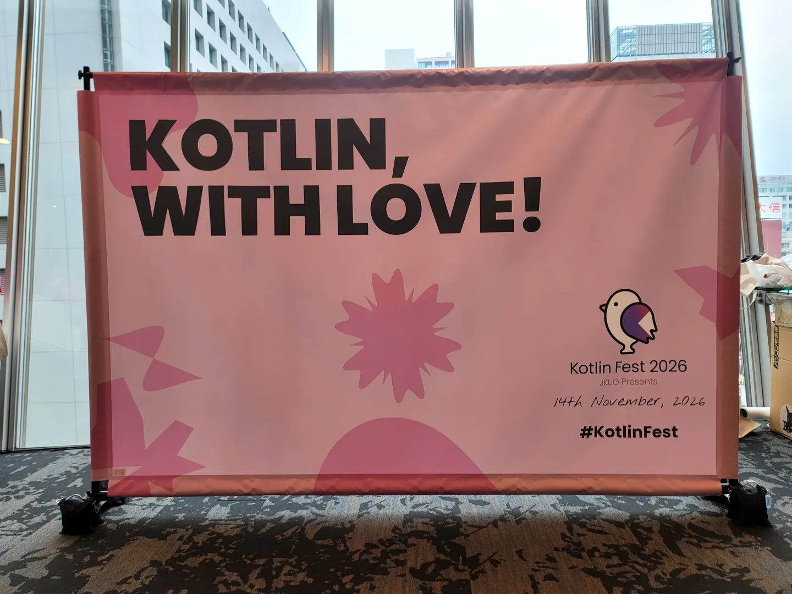
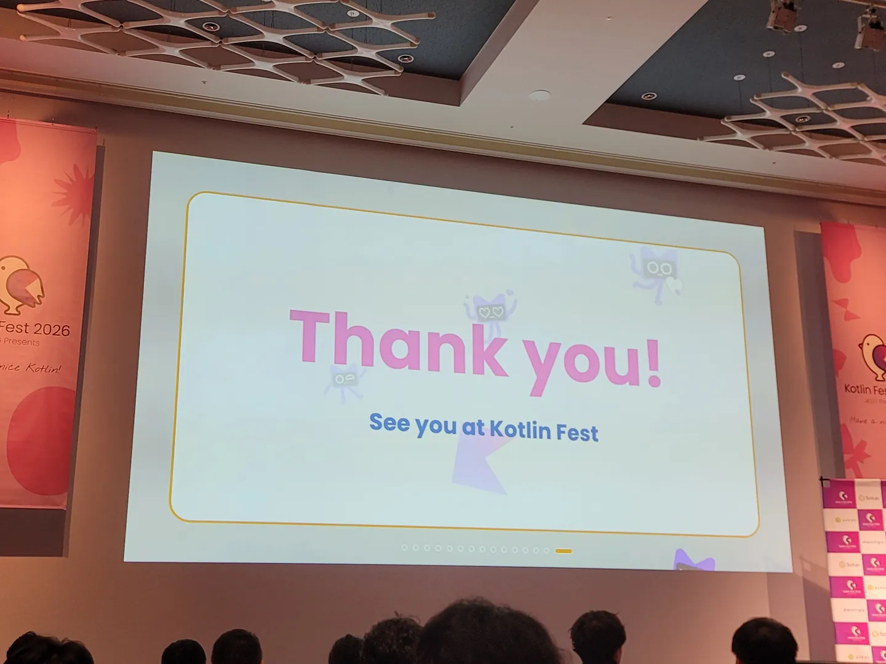

11月14日に品川で開催された[Kotlin Fest 2026](https://2026.kotlinfest.dev/)に、学生スカラーシップとして参加しました！

実はこの日は、チームで参加していた「[DevFest GDGoC Japan Hackathon 2026](https://df-hack26.gdgs.jp/)」の発表日とも重なっていました。どちらにも参加したかったのですが、Kotlin Festのスカラーシップのほうが先に決まっていたため、ハッカソンの発表はチームのメンバーにお願いしました。やってくれたメンバーに感謝です。

さて、Kotlin Festは、プログラミング言語Kotlinに関する知見や事例が共有される国内のカンファレンスです。このブログでは、聞いたセッションや会場の雰囲気、交流の中で教わったことを振り返ります。これから技術カンファレンスに参加してみたい学生の方の参考になれば幸いです。

## スカラーシップについて

学生スカラーシップは、金銭的・地理的な制約を和らげて、学生がカンファレンスに参加しやすくするための制度です。交通費やチケット代などを支援していただけます。

この制度を知ったのは、[マヤミト](https://x.com/yt8492)さんがXで募集をリポストしていたのがきっかけでした。マヤミトさんはAndroidアプリエンジニアの方で、今年3月の技育祭でお話しさせていただいてから、Xでつながっています。Kotlin Festではスタッフをされていました。

また、スカラーシップ生向けにはランチセッションも用意されていて、企業の方と直接お話しする機会がありました。

## 自己紹介とKotlinとの関わり

私は中央大学国際情報学部の2年生で、技術団体「[GDGoC Chuo](https://gdgoc-chuo.com/)」で活動しています。普段はWebフロントを中心に開発しています。

Kotlinに初めて触れたのは、GDGoC Chuoで開発している中央大学の学生向けアプリ「Chuinfo」のAndroid版でした。時間割や課題を確認できる統合アプリで、私にとっては初めてのAndroidアプリ開発でもあります。こちらは現在も運用を続けています。

また、9月に開催された「[Kotlin 15周年記念イベント](https://kotlin.connpass.com/event/402617/)」にも参加しました。それまでの私は、KotlinといえばAndroidアプリのための言語というイメージが強かったのですが、このイベントがサーバーサイドKotlinを知るきっかけになりました。とはいえKotlinはまだ勉強中で、Android以外での使われ方はまだ詳しく知らない状態でのKotlin Festへの参加でした。

## 会場・全体の雰囲気

会場は、人の温かさを感じる雰囲気でした。全体的に落ち着いていて、ゆったりと過ごすことができました。

ホールには、お菓子やホットコーヒー等が用意されていて、気軽にひと息つけたのもありがたかったです。

ちなみに、会場で流れていたドワンゴさんのCMには、ずんだもんが使われていて、遊び心を感じました。また、私がこれまでに参加した技術イベントでは、どこでもdipさんがスポンサーとして関わっていらっしゃり、コミュニティを継続的に支えている姿勢が印象的でした。

## 印象に残ったセッション

### Quarkusのセッション

「[共通基盤の実装に Kotlin / Quarkus を選定した理由と採用したアーキテクチャ](https://fortee.jp/kotlin-fest-2026/proposal/5c9a0c5c-5080-4a3b-8770-092fab2074d4)」を聞きました。長くPythonでサービスを提供してきた会社が、共通基盤の実装にKotlinとQuarkusを選んだ理由と、そのアーキテクチャを紹介するセッションでした。

Quarkus自体は知らなかったのですが、ブースでおすすめされたので聞いてみることにしました。QuarkusはJavaのフレームワークで、Kotlinでも利用できます。起動が速く、メモリの使用量も少ないため、クラウドやコンテナ上で動かすサービスに向いているそうです。

特に意外だったのは、KotlinはLLMと相性が良いという話です。Kotlinは比較的新しい言語なので、LLMが学習しているコードの量も少なく、その分苦手なのではないかと思っていました。

セッションでは、JavaやGoと比較しながら、Kotlinは「コードに書いてあることが全て」なので、LLMが文脈を推測せずに済む、という趣旨の話がありました。例えばKotlinでは、値がnullになりうるかどうかが型としてコード上に明示されます。JavaやGoでは、それらが型だけでは区別できないため、読む側が前後の文脈から推測する必要があります。Kotlinならその推測がいらないので、LLMも書かれている情報だけで正しく読み書きしやすい、ということだと思います。さらに、LLMが書いたコードに誤りがあっても、コンパイルの時点で見つけやすいという利点もありそうです。

学習データの量よりも、言語そのものの性質がLLMとの相性を左右するという視点は、とても新鮮でした。

### 関数型プログラミングのセッション

Kotlin Festの前代表である長澤太郎さんによる「[Arrowで学ぶ、関数型っぽくない関数型プログラミング](https://fortee.jp/kotlin-fest-2026/proposal/df0e5039-c43d-4b46-aa61-b62453fe4c6d)」を聞きました。関数型プログラミングについてはほとんど知らなかったため、チャレンジのつもりで聞きました。

正直なところ、内容はほとんど理解できませんでした。参照透過性やモナドなど、分からない言葉も多くありました。ただ、こういう書き方もあるのだと知れたのは良い勉強になりました。

## ランチセッション

スカラーシップ生向けのランチセッションでは昼ごはんが用意されていて、いくつかのスポンサー企業の方と一緒にいただきながらお話ししました。そこでは、就職先を選ぶときに、1つのプロダクトに集中している会社と、たくさんのプロダクトを抱えている会社のどちらを選ぶかは重要だという話を伺いました。社内で異動できるかどうかや、配属がどう決まるかなど、どちらにもそれぞれの良さがあるそうです。これから就職活動をするうえで、意識しておきたい視点だと感じました。

## 企業ブース

企業ブースは全て回ってお話しさせていただき、今後に向けたアドバイスもたくさんいただきました。例えば、新卒のモバイルアプリエンジニアは重宝されるという話や、Jetpack Composeを学んでおくと良いという話を伺いました。

また、Fairy Devicesさんのブースでは、工事現場などで使われている肩掛け型のウェアラブルデバイス「THINKLET」が展示されていました。申請して審査に通れば貸し出してもらえるそうで、とても興味を持ちました。私は人間の感覚とシステムの組み合わせを研究領域としているため、身につけた人の視点で映像や音を記録できるこのデバイスは、研究にも活かせそうです。

## 懇親会

全てのセッションが終わったあとは懇親会があり、学生同士で自然に集まって話し、その後、社会人の方ともお話しさせていただきました。

なかでも響いたのが、作ったものはGitHubで公開するだけでなく、アプリストアやChrome Web Storeに出して「出荷」することが大事だ、という話です。私が作っている[大学向けのChrome拡張機能](/univ-extensions/)も、今はGitHubで公開しているだけなので、まずはストアに出すところから取り組みたいと思います。

## おわりに

今回の参加を通して、サーバーサイドKotlinや、KMP (Kotlin Multiplatform) を使ったiOSとAndroidの共通化など、Android以外でのKotlinの活用について知ることができました。iOSのUIはSwiftUIで書きつつ、Androidと共通化できる部分はKMPで共通化している例も多いそうです。モバイルエンジニアという仕事についても、以前より具体的にイメージできるようになりました。

また、セッションの内容からは少し離れますが、個人的に考えたこともあります。日本では若い世代を中心にiPhoneのシェアが高く、個人向けのアプリではiOSが優先されることも多いように感じます。その中でAndroidエンジニアとして活動するなら、業務用に配布される端末や飲食店の注文用端末など、特定の用途に特化した専用端末が大きな活路になるのかもしれない、ということです。

聞けなかったセッションは、アーカイブで見てみるつもりです。来年もKotlin Festに参加したいですし、次は周りの人もスカラーシップに誘ってみようと思います。また、余っていたノベルティのトートバッグを譲っていただいたので、GDGoC Chuoのメンバーに配ろうと思います。

最後に、スカラーシップを知るきっかけをくださったマヤミトさん、登壇者の皆さん、ブースやランチでお話ししてくださった企業の方々や参加者の皆さん、そしてKotlin Festを支えてくださったスポンサーの皆さん、スタッフの皆さん、本当にありがとうございました！

